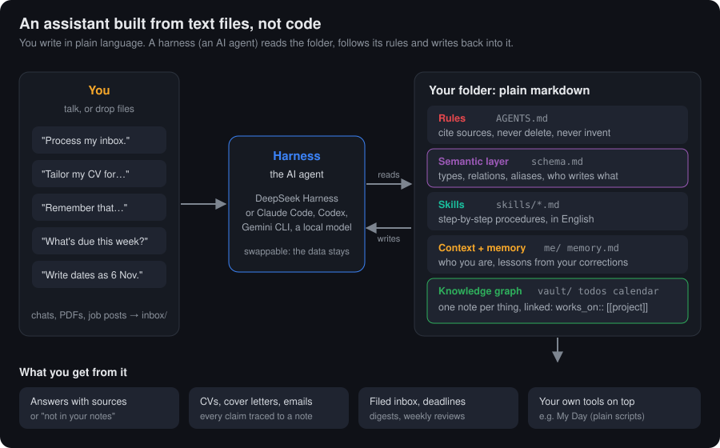
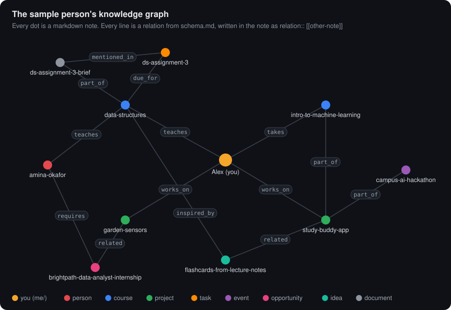

# Build your own AI assistant, without writing code

A personal assistant made of plain markdown files. You describe yourself,
what things mean and how you like tasks done, in plain language. An AI
**harness** (DeepSeek Harness, Claude Code, Codex…) reads the folder, follows
it, and writes what it learns back into it.

It doesn't need code, a server or a database: you change how it behaves by
editing a text file.



## The idea in three parts

1. **Your data, as markdown:**
   - who you are (`me/`);
   - everything you know, one note per person, course, project, event or
     opportunity (`vault/`);
   - your todos and calendar.

   You can open, edit, back up and move every file.
2. **A semantic layer** (`schema.md`): the *data contract* between you and
   any AI. It says what kinds of things exist in your life (types), how they
   connect (relations), what your shorthand means (aliases) and who may write
   what (ownership). The agent must follow it, so your notes stay a clean,
   linked **knowledge graph** instead of a pile of chat logs.
3. **A harness** that does the work: it reads the rules (`AGENTS.md`),
   follows written procedures (`skills/`), learns from your corrections
   (`memory.md`) and logs every change (`logs/actions.md`).

   Swap the harness or the model whenever you like. Your data and its
   meaning stay in the folder.

## The knowledge graph

Each note has a type and links to other notes with *typed* relations from
the schema. That's what lets the agent answer "what do I need for this
application?" by following links instead of guessing.



One note, as the agent writes it (`vault/projects/study-buddy-app.md`):

```markdown
---
type: project            ← a type from schema.md
name: Study Buddy
status: active
deadline: 2026-11-12
aliases: the app, capstone
source: sample           ← where the facts came from
---
Capstone web app that turns lecture notes into flashcards…

part_of:: [[intro-to-machine-learning]]      ← relations from schema.md
related:: [[flashcards-from-lecture-notes]]
```

Open the folder in [Obsidian](https://obsidian.md) and press Ctrl+G to see
and explore the graph. `python tools/sample.py load` colours it by note type.

## How a fact gets in: the data contract in action

You say *"Process my inbox"*, and a WhatsApp export says "our demo moved to
14:30":

1. **Read the contract.** The harness reads `AGENTS.md`, `schema.md` and the
   `ingest` skill.
2. **Classify.** "Demo day" is an `event`; "the app" is the alias for
   `study-buddy-app`.
3. **Find before create.** The event note already exists, so it's updated,
   never duplicated.
4. **Link and cite.** The note gets `mentioned_in:: [[the-chat-document]]`,
   so every fact has a source.
5. **Respect ownership.** The calendar is updated. New tasks are only
   *suggested*: your todo list and goals are yours.
6. **Log.** Each change is one line in `logs/actions.md`, and the original
   moves to `archive/`. Nothing is deleted.

Ask *"When is my demo?"* later, and the answer comes back with
`[[campus-ai-hackathon]]` as its source, or "that's not in your notes".

## Quick start

1. **Get the folder.** Click **Use this template** on GitHub (make it
   **private**), or clone it.
2. **Open it in your harness.**
   - **DeepSeek Harness:** open the folder as your workspace.
   - **Claude Code:** run `claude` in the folder.
   - **Codex, Gemini CLI…:** tell it to read `AGENTS.md` first.

   The harness reads `AGENTS.md` and takes it from there.
3. **Tell it about you.** Say: *"Interview me to fill in my profile, goals
   and preferences."* Or fill in `me/` yourself.
4. **Feed it.** Drop files into `inbox/` (your CV, a course outline, a job
   posting, a chat export) and say *"Process my inbox."*

To explore first with a fictional student, Alex (needs Python 3.9+):

```
python tools/sample.py load     # Alex's profile, CV, todos, calendar and 10 linked notes
python tools/sample.py inbox    # 5 messy files (chat, brief, job post…) to process
python tools/sample.py clear    # Alex moves to archive/, blank templates come back
```

[DEMO.md](DEMO.md) is a guided 20-minute walkthrough with Alex.

## Make it yours, in plain language

| You want to… | Edit | Example |
|---|---|---|
| Track a new kind of thing | `schema.md` → Note types | Add a `client` type with `company` and `rate` fields |
| Connect things a new way | `schema.md` → Relations | `mentors`: person → person |
| Teach it your shorthand | `schema.md` → Aliases | "DS" means `[[data-structures]]` |
| Give it a new ability | `skills/<name>/SKILL.md` | A numbered list of steps in English, e.g. "weekly invoice" |
| Change a rule | `AGENTS.md` | "Never message anyone without asking me" |
| Fix a habit | Just say it | "Write dates as 6 Nov, not 2026-11-06." It goes into `memory.md` |
| Set your style | `me/preferences.md` | British spelling, short digests |

## What you can ask

| Ask | Skill | What you get |
|---|---|---|
| "Process my inbox." | `ingest` | Files filed into the graph, deadlines in the calendar, suggested todos |
| "Remember that…" | `capture` | A linked note, no copy-paste |
| "What do I know about…?" | `ask-my-notes` | An answer with citations, or "not in your notes" |
| "Tailor my CV for this job: …" | `tailor-resume` | Requirement → evidence → source table, a one-page CV, honest gaps |
| "Write a cover letter for …" | `cover-letter` | One clear argument, every claim traced to your notes |
| "Reply to this email…", "Write my bio…" | `draft-with-my-context` | Ready-to-paste text using real names, dates and results |
| "What should I do today?" | `todos` | Top 3 with reasons |
| Morning, evening, Sunday | `morning-digest`, `evening-check-in`, `weekly-review` | Digests in `digests/` |

The agent never invents experience, dates, grades or skills. For anything
you'll send, it ends with one thing for you to check yourself.

## Build on top: My Day (optional)

Once your life is in plain files, small scripts can use them too. **My Day**
is one example: a little window and a `day` terminal command for your
todos, calendar and goals, with reminder pop-ups.

It's plain Python and needs no AI, except two optional buttons: **?** to ask
and **✦ Suggest** to plan your day. Those can use your harness or a free
local model. See [docs/my-day.md](docs/my-day.md).

## Keep it private

Once you fill it in, this folder holds your life. **Never push a filled-in
copy to a public repository.** Use a private repo, or no remote at all.
`.gitignore` already keeps out config secrets, caches and generated
applications.

## Folder map

```
AGENTS.md          rules for the agent (CLAUDE.md points here)
schema.md          semantic layer: types, relations, aliases, ownership
me/                profile, goals, preferences, master CV
vault/             knowledge graph: one folder per note type
todos.md           your todo list (you add; the agent suggests)
calendar.md        events and deadlines
memory.md          lessons from your corrections
skills/            procedures the agent follows, in plain English
inbox/             drop files here
archive/           originals and anything removed (nothing is deleted)
digests/           daily digests and weekly reviews
logs/actions.md    every file change
tools/             optional scripts: My Day, day command, sample loader, calendar sync
examples/          Alex (sample person), demo inbox, blank templates
docs/              images and the My Day guide
```

## Licence

MIT. See `LICENSE`.
