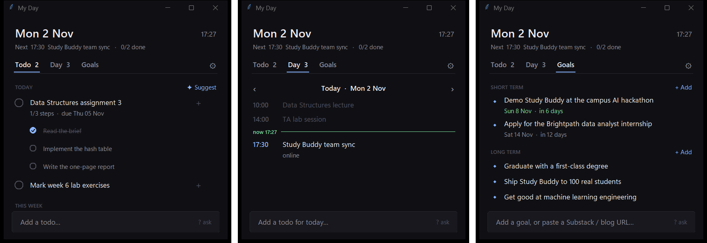

# My Day: a tool built on top of your assistant

My Day is an example of what you can build once your life is in plain files.
It's a small window and a `day` command over the same `todos.md`,
`calendar.md` and `me/goals.md` the agent uses.

It's plain Python scripts with no AI. Ticking, adding, reordering, the
calendar view, goals and reminder pop-ups all work offline, without any
model. Only two buttons call an AI, and only when you click them: **?** to
ask a question and **✦ Suggest** to plan your day.



## Install

You need Python 3.9 or newer, standard library only. On Windows, run in the
folder:

```powershell
powershell -ExecutionPolicy Bypass -File setup.ps1
```

It asks before each step:
- put `day` on your PATH;
- show My Day each morning;
- load the sample person;
- open the window.

On macOS or Linux, run `python3 tools/day_ui.py` for the window, and add
`tools/` to your PATH for the `day` command (`tools/day`).

## What it does

### Todo tab

- **Lists:** Today, This week and Later, from `todos.md`. Click a todo to
  tick it.
- **Steps:** hover a todo for **+** to add steps. To stop adding, press
  Enter on an empty line or click **Done**.
- **Remove:** hover for **✕**. The todo moves to the archive; Ctrl+Z
  undoes it.
- **Reorder:** drag a todo up or down, or into another list.
- **✦ Suggest:** looks at today's schedule and free time, the next 7 days,
  your goals and your open todos. It proposes 3 todos, each placed in a free
  slot. You choose which to add.

### Day tab

Your calendar, one day at a time, with a "now" line.

### Goals tab

- **Goals:** short term and long term. Click a goal to edit it; hover to
  move it, mark it achieved or remove it. Dated goals appear in the calendar.
- **Reading list:** your feeds, ranked by your interests and goals. Paste a
  blog, Substack or YouTube URL to add a feed.

### Pop-ups

A pop-up before timed events, and a check-in every 40 minutes between 08:00
and 22:00. Change both under **⚙**.

### Terminal

`day ls`, `day add "…"` (add `--week` or `--later`), `day done 2`,
`day done 1.2`, `day step 1 "…"`, `day rm 3`, `day goals`, `day ask "…"`.

The window watches the files, so edits by you or the agent show up within
seconds.

## No wasted AI calls

- **When the API is called:** only when you press ✦ Suggest, ask with
  **?**, or run `day ask`.
- **Saved suggestions:** kept for 2 hours while your todos, calendar and
  goals don't change. Pressing again, or restarting, costs nothing.
- **Local model:** with a local model, suggestions are prepared in the
  background while the window is open, because that's free.
- **What it spent:** every call is a line in `logs/ai-calls.log`, and ⚙
  Settings → Assistant shows today's count.

## API or local model

Choose in **⚙ Settings → Assistant → Answered by**:

| Setting | What answers |
|---|---|
| **auto** (default) | The API agent first. If it can't answer (not installed, no key, offline), the local model takes over, and the API isn't retried for 10 minutes. |
| **api** | Only the API agent. |
| **local** | Only a model on your laptop: private, and works offline. |

**Local model:** install [Ollama](https://ollama.com), then run
`ollama pull qwen3.5:4b`. Pick the model under **Settings → Local model**.

A local model can't open files, so My Day pastes in your profile, goals,
todos, calendar and the notes that best match your question. Small models
make more mistakes: check what they tell you.

**API agent:** set `"assistant_command"` in `tools/day_ui.config.json` to a
command that reads a prompt on stdin and prints the answer:

- **DeepSeek Harness:** `["<path to>/dsh.cmd", "--profile", "headless", "-"]`.
  `dsh.cmd` is in the app's `resources/runtime/cli/bin/`. Headless runs need
  your model provider's API key as an environment variable.
- **Claude Code:** `["claude", "-p", "--model", "{model}", "--allowedTools", "{tools}"]`.
- **Any other agent:** any command that reads a prompt on stdin and prints
  the answer.

## Optional: Google Calendar

1. Copy `tools/gcal_sync.config.example.json` to `tools/gcal_sync.config.json`.
2. Paste in your calendar's secret iCal address (Google Calendar → Settings
   → Integrate calendar).
3. Run `python tools/gcal_sync.py` on a schedule, e.g. every 5 minutes in
   Task Scheduler.

## Optional: phone notifications

`tools/notify.py` can send notifications to your phone through the free ntfy
app:

1. Copy `tools/notify.config.example.json` to `tools/notify.config.json`.
2. Set a long, random topic name. Anyone who knows the topic can read your
   notifications.

## Undo the setup

```powershell
Unregister-ScheduledTask "My Day morning"
```

Then remove the `tools` folder from your user PATH (Settings → System →
About → Advanced system settings → Environment Variables).
